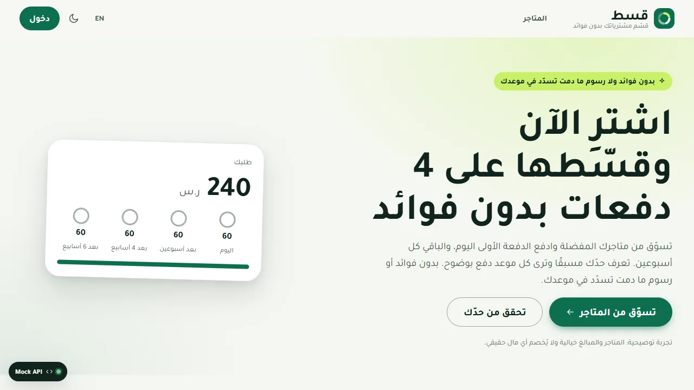

<div align="center">

# قسط · Qist

**Buy now, pay later in 4 interest-free instalments, with a merchant dashboard**

[](https://abdulhadi.review/projects/qist/) [](https://abdulhadi.review)

`React 19` · `TypeScript` · `CSS Modules` · `Figma`



</div>

---

<div dir="rtl" align="right">

## عن المشروع

**تقسيط المشتريات ولوحة تاجر** · 2026

منصة اشترِ الآن وادفع لاحقاً تعمل كاملة في المتصفح: فحص هوية وأهلية يحدد حدّ الشراء، ومتاجر شريكة تعرض خطط الدفع (4 دفعات كل أسبوعين، 3 أو 6 دفعات شهرية، أو الدفع بعد 30 يوماً) بجدول واضح قبل التأكيد، وبطاقات محفوظة ودفع تلقائي، وقاعدة تأخير معلنة. ولوحة تاجر بالطلبات والتسويات والاسترداد الجزئي الذي يعدّل جدول العميل.

**المشكلة:** التقسيط كثيراً ما يخفي رسومه خلف نصوص طويلة، فلا يعرف المتسوّق كم سيدفع ومتى، ولا ماذا يحدث إن تأخر، ولا يعرف التاجر متى يصله ماله.

**الحل:** جدول دفعات بالتواريخ والمبالغ قبل الدفع، وحدّ شراء ظاهر قبل الطلب وبعده، وقاعدة تأخير مكتوبة بوضوح، وسداد مبكر بلا غرامة، وللتاجر تسويات بموعدها وصافيها بعد الرسوم.

### أبرز المزايا

- فحص الهوية والأهلية وحدّ شراء يرتفع بالالتزام
- أربع خطط تقسيط بجدول دفعات يطابق الإجمالي بالضبط
- بطاقات محفوظة بتحقق Luhn ودفع تلقائي ودفع الدفعة أو السداد المبكر
- رسوم تأخير معلنة: 29 ريالاً بسقف 20% وبحد أقصى مرتين
- تقويم الدفعات القادمة وتنبيه بالمتأخر
- لوحة تاجر: طلبات، تسويات بعد الرسوم، واسترداد جزئي
- عربي/إنجليزي، فاتح/داكن، والجوال أولاً

</div>

---

## Run locally

```bash
npm install
npm run dev        # http://localhost:<port>/projects/qist/
npm run build      # type-check, build and prerender to dist/
```

Runs fully in the browser on a built-in mock server, so no backend is needed. `core/` holds the shared plumbing (service layer, auth, i18n, theme, router, formatters) used by all my portfolio apps.

## Technical notes

# قسط · Qist

Buy now, pay later for Saudi shoppers — split a purchase at a partner store into 4 payments every two weeks, 3 or 6 monthly
payments, or pay in full after 30 days, at 0% cost to the shopper, inside a spending limit that grows as you pay on time —
plus a merchant dashboard with orders, refunds and T+2 settlements. Frontend-only with an in-browser mock API, deployed at
`https://abdulhadi.review/projects/qist/`. Arabic (RTL) first with English, light/dark, phone-first. The fees, limits and
late-fee rules are a demo model inspired by SAMA's BNPL rules, not legal advice.

```bash
npm run dev:qist        # from the repo root → http://localhost:5189/projects/qist/
npm run build           # from the repo root → dist/projects/qist/
```

**Try it:** sign in as the demo shopper لمى (`0551234567`, code `1234`). She is approved with a SAR 5,000 limit and has three
plans: a Pay in 4 whose next instalment is due in 3 days (autopay is on), a Pay in 3 months with an instalment 2 days late
(a SAR 29 late fee applies), and a finished Pay in 6 months. Open Upcoming and Plans, pay the late instalment, settle a plan
early, switch autopay, and add a card in Wallet (`4111 1111 1111 1111` works; `4000 0000 0000 0002` is declined at
checkout). Pick any product from a store, compare the four plans' schedules in the checkout, and confirm. A new phone number
goes through Verify identity: ID `1001000000` (any income) is approved instantly, `1234567890` with "Not working" goes through a
short manual review, and `2000000000` with "Not working" is declined with a date to retry. Then sign in as the merchant
مجوهرات نسمة (`0500003333`, code `1234`): look at the 30-day sales and plan mix, open an order, refund part of it (future
instalments shrink proportionally) and check the settlement batches (6% + SAR 1 fee, paid T+2 working days, Sunday–Thursday).

Demo accounts: one-tap buttons on the sign-in page; the code is shown on screen in mock mode (`1234`). The mock database
re-seeds itself when the day changes, so the demo always has a due-soon plan and a late one.

## Structure

```
src/
  api/          types.ts · services.ts · plans.ts (plan catalogue, schedules, late fee, limit, merchant fee, T+2, refunds) · cards.ts (Luhn, brand, expiry) · util.ts (Riyadh dates, halalas) — shared by UI and mock
  mock/         server.ts (auth, stores, limit, quote, checkout, plans, cards, merchant) · seed.ts (12 stores, 72 products, demo shopper and merchant, relative dates) · none.ts (empty stand-in when VITE_USE_MOCK=false)
  state/        session (phone OTP) · checkout (basket draft) · guard (sign-in redirect) · store
  components/   Shell · Qist (mark, limit ring, segment bar, card form, method picker) · Gate · DevPanel · Icon · ui
  lib/          fmt (dates, Hijri, labels, errors) · hooks
  i18n/         ar · en
  pages/        Home · Stores · Store · Pay · Verify · Plans · Plan · Upcoming · Wallet · Auth · Account · merchant/{Merchant, Overview, Orders, Settlements}
docs/           api-contract.md · database-schema.md · architecture.md
```

Switch to a real backend with `VITE_USE_MOCK=false` and `VITE_API_URL=…` (see `docs/architecture.md`).

---

Designed and built by **Abdulhadi Almohammad** ([@abood352](https://github.com/abood352)) · [abdulhadi.review](https://abdulhadi.review)
