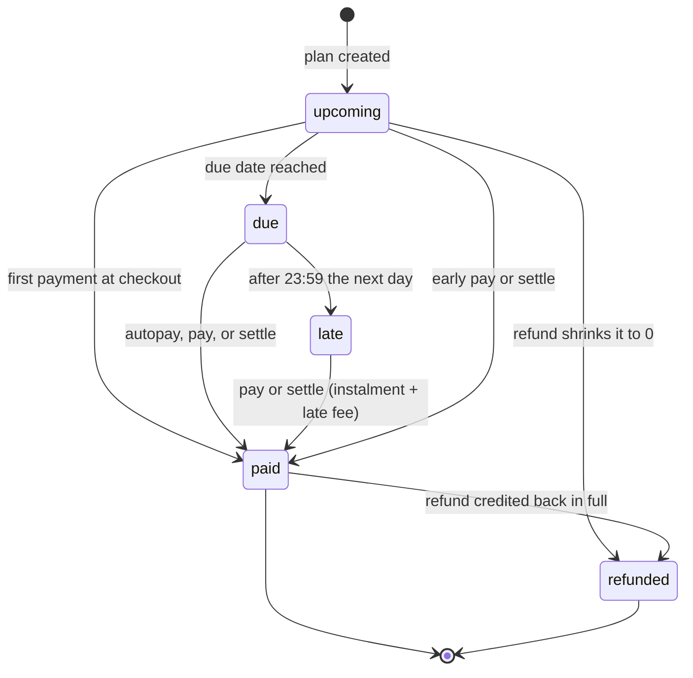
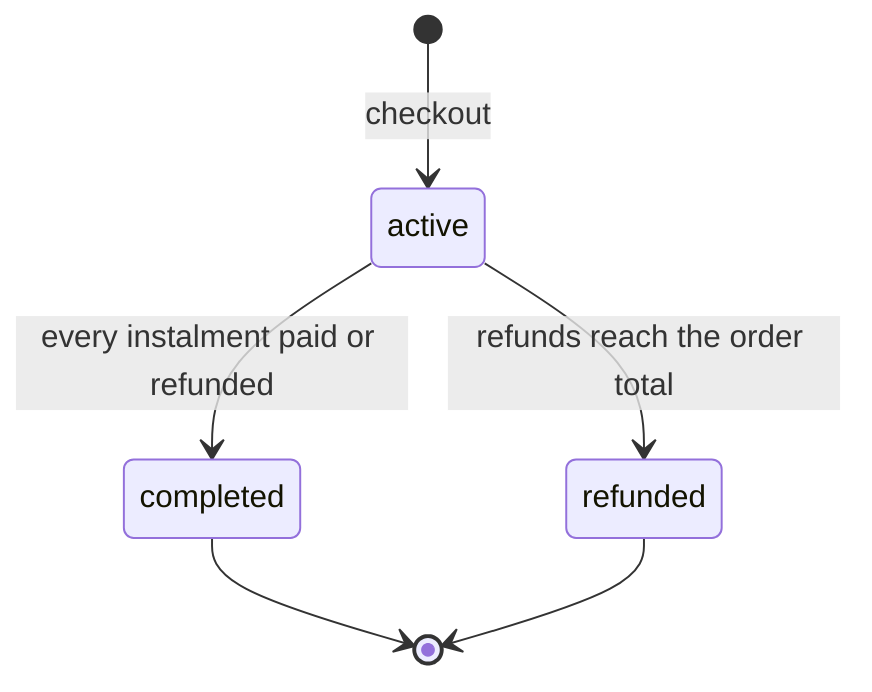

# Qist — API contract (v1)

Every endpoint the frontend calls, exactly as the in-browser mock implements it
(`src/mock/server.ts`). Switch the frontend to the real API with:

```bash
# apps/qist/.env.local
VITE_USE_MOCK=false
VITE_API_URL=https://api.qist.example/api/v1
```

Endpoint paths live only in `src/api/services.ts`; wire types in `src/api/types.ts`; the money rules
(plan catalogue, schedules, late fees, limit, merchant fee, refunds) in `src/api/plans.ts`, card validation in
`src/api/cards.ts` and date helpers in `src/api/util.ts`, all shared by the UI previews and the server.

> **Everything below about fees, limits and late rules is a DEMO model.** The numbers are approximate and
> inspired by, not a statement of, Saudi regulation (SAMA's BNPL rules). It is not legal or financial advice;
> a real launch needs a licensed entity and a compliance review.

## Conventions

| Topic | Rule |
| --- | --- |
| Base URL | `/api/v1` |
| Format | JSON, UTF-8. Timestamps (`createdAt`, `paidAt`) ISO-8601 UTC. **Instalment due dates, settlement dates and `retryAfter` are local Riyadh dates `YYYY-MM-DD`** (UTC+3, no DST) and are never converted. |
| Money | SAR, JSON numbers with at most **2 decimals** (`254.5`). The server computes in halalas (integers) so sums are exact; the database stores integer halalas (see `database-schema.md`). |
| Localised text | `L = { ar, en }` |
| Auth | `Authorization: Bearer <JWT>` with claims `sub`, `role` (`shopper` \| `merchant`), `name`, `exp`. A merchant user has a `storeId` and only ever sees that store's orders. |
| Pagination | `page`, `limit` (max 100) → `{ items, page, limit, total, pages }`; `page` is clamped into range. Defaults: `GET /products` 12 per page, `GET /merchant/orders` 10. Other lists are not paginated. |
| Errors | `{ "error": { "code", "message", "details"? } }`. `details` maps a field to a code (`REQUIRED`, `INVALID`, `EXPIRED`, `DECLINED`, `TOO_LARGE`, `NEEDS_CARD`, `EXCEEDS_REMAINING`, `BELOW_MIN`, `ABOVE_MAX`, …); the UI translates codes. `401` clears the session, `403` = wrong role. |
| Public routes | `POST /auth/otp`, `POST /auth/verify`, `GET /stores`, `GET /stores/:id`, `GET /products` need no token. |

### Error codes

| HTTP | `code` | When |
| --- | --- | --- |
| 401 | `UNAUTHENTICATED` | No/invalid token, or the user no longer exists |
| 401 | `OTP_INVALID` | Wrong one-time code (`details: { code: INVALID }`) |
| 402 | `CARD_DECLINED` | The card was declined (`details: { paymentMethodId: DECLINED }`); nothing is stored |
| 403 | `FORBIDDEN` | Wrong role (shopper on a merchant route and vice versa), or a merchant account without a store |
| 403 | `NOT_APPROVED` | Checkout by a user who is not approved (`details: { status }`) |
| 404 | `ROUTE_NOT_FOUND` | Unknown path |
| 404 | `OTP_NOT_FOUND` | Unknown `requestId` |
| 404 | `STORE_NOT_FOUND` | Unknown store id |
| 404 | `PLAN_NOT_FOUND` | Unknown plan id/code, or not yours |
| 404 | `PAYMENT_NOT_FOUND` | Unknown instalment number on a plan |
| 404 | `CARD_NOT_FOUND` | Unknown card id, or not yours |
| 404 | `ORDER_NOT_FOUND` | Unknown order id/code, or not your store's |
| 409 | `ALREADY_APPROVED` | Eligibility check by an already approved user |
| 409 | `REVIEW_PENDING` | Eligibility check while a manual review is running |
| 409 | `RETRY_LATER` | Re-applying before the decline cool-down ends (`details: { retryAfter }`) |
| 409 | `LIMIT_EXCEEDED` | The order exceeds the available limit for the chosen plan (`details: { available }`) |
| 409 | `ALREADY_PAID` | Paying an instalment that is already paid or refunded |
| 409 | `PAY_IN_ORDER` | Paying instalment *n* while an earlier one is still unpaid |
| 409 | `NOTHING_TO_SETTLE` | Early settlement of a plan with no unpaid instalment |
| 409 | `CARD_LIMIT` | More than 5 saved cards |
| 409 | `CARD_EXISTS` | Same brand + last 4 + expiry already saved |
| 409 | `CARD_IN_USE` | Removing a card that an active autopay plan uses |
| 409 | `ALREADY_REFUNDED` | Refund of an order that is fully refunded |
| 410 | `OTP_EXPIRED` | Code older than 5 minutes |
| 422 | `VALIDATION` | Field errors in `details` |
| 422 | `CARD_EXPIRED` | Charging a saved card past its expiry (`{ paymentMethodId: EXPIRED }`) |
| 422 | `PLAN_NOT_ALLOWED` | Plan outside its min/max for the order (`{ planType: BELOW_MIN \| ABOVE_MAX }`) |
| 429 | `RATE_LIMITED` | 3 codes requested within a minute for one phone |
| 429 | `OTP_LOCKED` | 5 wrong tries |

The client also raises `NETWORK` (status 0) when the API is unreachable.

### Shared shapes

```ts
PlanType = 'pay4' | 'pay3' | 'pay6' | 'later30'
PaymentStatus = 'paid' | 'due' | 'upcoming' | 'late' | 'refunded'
PlanStatus = 'active' | 'completed' | 'cancelled' | 'refunded'     // 'cancelled' is declared but never produced yet
EligibilityStatus = 'none' | 'pending' | 'approved' | 'declined'
IncomeBand = 'lt5k' | '5k_10k' | '10k_20k' | 'gt20k'
EmployerType = 'government' | 'private' | 'self' | 'retired' | 'student' | 'unemployed'
CardBrand = 'mada' | 'visa' | 'mastercard'
StoreCategory = 'fashion' | 'electronics' | 'home' | 'beauty' | 'kids' | 'travel'
IneligibleReason = 'NOT_APPROVED' | 'BELOW_MIN' | 'ABOVE_MAX' | 'LIMIT_EXCEEDED'

Eligibility = { status, limit /* effective SAR limit, 0 unless approved */, reason?: 'LOW_SCORE', retryAfter?: 'YYYY-MM-DD' }
User = { id, name, phone /* +9665… */, role, storeId: string|null, eligibility: Eligibility, createdAt }
Store = { id, name: L, tagline: L, categories: StoreCategory[], palette: [a, b] }
StoreRef = { id, name, palette }
StoreSummary = Store & { products: number }
Product = { id, storeId, title: L, price, palette: [a, b] }
StoreDetail = Store & { products: Product[] }
ProductListItem = Product & { store: StoreRef }
OrderItem = { title: L, price, qty }
PayMethodRef = { type: CardBrand | 'applepay', last4?: string }
Payment = { n, dueDate, amount /* still to pay, reduced by refunds before it is paid */, status: PaymentStatus,
  paidAt?, method?: PayMethodRef, lateFee /* 0 unless late or paid late */, refunded }
Plan = { id, code /* QS-48101 */, store: StoreRef, items: OrderItem[], total, planType, payments: Payment[], status: PlanStatus,
  lateFees /* sum of late fees, paid or owed */, refunded, createdAt, paymentMethodId /* card id or 'applepay' */, autopay,
  paid /* instalment amounts already paid */, remaining /* unpaid instalments + late fees due */,
  nextDue: { n, dueDate, amount /* incl. late fee */, daysUntil } | null /* only while active */ }
LimitInfo = Eligibility & { baseLimit, used /* principal outstanding on active plans */, available, onTimePlans,
  nextIncrease: { plansLeft, amount, newLimit } | null, decidesAt?: epoch-ms /* pending reviews */ }
QuoteOption = { plan, eligible, reason?: IneligibleReason, limitLeft, firstPayment, payments: { n, dueDate, amount }[] }
Quote = { total, status, limit, available, options: QuoteOption[] /* one per plan, in catalogue order */ }
Card = { id, brand, last4, expiry /* MM/YY */, default }
UpcomingItem = { planId, code, store: StoreRef, n, of, dueDate, amount /* instalment + late fee */, lateFee, status: 'due'|'upcoming'|'late', autopay }
Upcoming = { overdue: UpcomingItem[], groups: { date, total, items: UpcomingItem[] }[], total }
MerchantOrder = Plan minus { paymentMethodId, autopay, nextDue }
  & { customer /* first name + initial */, fee, net, settleDate, settled }
MerchantStats = { store: StoreRef, sales, salesToday, orders, ordersToday, avgOrderValue, conversionUplift /* demo figure, %, not measured */,
  pendingSettlement, nextSettlement: date|null, series: { date, sales }[30], planMix: { plan, orders }[4] }
Settlement = { date, status: 'paid'|'pending', orders, gross, fee, net }
Settlements = { pending, paid, nextDate: date|null, batches: Settlement[] }
```

`due` and `late` are **derived on every read** from today's date; they are never stored. A stored instalment is only
`upcoming`, `paid` or `refunded`.

## Plan catalogue (`src/api/plans.ts`)

Every plan is interest-free with **0% cost for the shopper**; the store pays the fee (see "Merchant fee").

| Plan | Payments | Spacing | Paid at checkout | Order min | Order max | Counts against the limit |
| --- | --- | --- | --- | --- | --- | --- |
| `pay4` | 4 | every **14 days** | the 1st | SAR 40 | none (limit only) | total − first payment |
| `pay3` | 3 | monthly | the 1st | SAR 90 | none (limit only) | total − first payment |
| `pay6` | 6 | monthly | the 1st | SAR 500 | none (limit only) | the whole order |
| `later30` | 1 | **+30 days** | nothing (pay later) | SAR 40 | SAR 1,500 | the whole order |

- Any order total is capped at **SAR 20,000** (`MAX_ORDER`, `VALIDATION { total | items: INVALID | TOO_LARGE }`).
- **Monthly dates** are computed from the order date (`start + k months`), clamping the day to the end of a short
  month: ordering on 31 Jan gives 31 Jan, 28 Feb (29 in a leap year), 31 Mar. Clamping is not cumulative.
- **Cents distribution.** The total is split in halalas: `base = floor(total / count)`; the remainder goes into the
  **first** payment, so the sum is exactly the total. SAR 1,018 in 4 → 254.50 × 4; SAR 100.01 in 3 → 33.35, 33.33, 33.33.
- **Eligibility reason precedence** for a plan: `NOT_APPROVED` → `BELOW_MIN` → `ABOVE_MAX` → `LIMIT_EXCEEDED`.

## Rules

- **Instalment states.** `upcoming` until its due date, `due` from the due date, still on time through **23:59 of the
  next day** (grace, `GRACE_DAYS = 1`), `late` afterwards. Paid instalments stay `paid`; a fully refunded one is `refunded`.
- **Late fee (DEMO rule inspired by SAMA's BNPL rules, not legal advice).** SAR **29** per late instalment, capped
  so that all fees on a plan never exceed **20% of the order total**, and at most **2** fees per plan
  (`lateFeeFor`: `min(29, 20% × total − fees already applied)`, 0 once two have been applied). The fee is derived while the
  instalment is late and **frozen into the instalment when it is paid** (`lateFee`). It is never charged silently.
- **Pay in order.** Instalment *n* can be paid only when every earlier instalment is no longer `upcoming`
  (`409 PAY_IN_ORDER`). Paying a due or late instalment charges `amount + lateFee`.
- **Early settlement.** Any time, no penalty: `POST /plans/:id/settle` pays every unpaid instalment at once (late fees
  of already-late instalments still apply). The plan is interest-free, so the total never changes.
- **Plan status.** `refunded` once refunds reach the order total; otherwise `completed` when every instalment is paid
  or refunded; otherwise `active`.
- **Autopay.** New checkouts paid with a saved card get `autopay: true` (Apple Pay: `false`). Autopay charges instalments
  that are `due` (not yet late) with the plan's saved card if it exists, is not expired and is not a declined card; it
  **never** charges a late instalment. In the mock this runs when the shopper opens the app (`GET /plans`, `GET /me/upcoming`);
  a real backend runs it as a nightly job (see `architecture.md`).
- **Limit.** `limit = base + SAR 500 × floor(onTimePlans / 3)` capped at SAR 10,000, where `onTimePlans` counts completed
  plans with no late fee and `base` comes from the eligibility check. `used` = principal still outstanding on active
  plans (unpaid instalments, late fees excluded); `available = max(0, limit − used)`. `nextIncrease` tells how many
  more on-time plans earn the next +500 (`null` at the top tier). The limit is 0 unless approved.
- **Eligibility decision (mock bureau).** A stable pseudo score 0–100 from the national ID (FNV hash) and employer
  (government +10, private/retired +5, self 0, student −10, unemployed −15). Score < 40: `declined` (`LOW_SCORE`,
  retry after 30 days). 40–47: `pending` manual review, resolved to `approved` with a SAR 1,500 limit about 8 seconds later
  (`decidesAt`; resolved lazily on the next read). Otherwise `approved` with the limit of the income band
  (`lt5k` 1,500 · `5k_10k` 3,000 · `10k_20k` 5,000 · `gt20k` 10,000), one tier lower when the score is below 55 (minimum 1,500).
  The national ID (10 digits starting with 1 or 2, no checksum in the demo) is never stored, only the outcome.
- **Merchant fee (demo MDR).** `fee = 6% × net order value + SAR 1`, where net value = `total − refunded` (0 when
  nothing is left). `net = value − fee`. The store is settled for the **whole order**, not instalment by instalment;
  Qist carries the shopper's credit risk.
- **Settlement date.** Order date + **2 working days (T+2)** on a Sunday–Thursday week (Friday and Saturday skipped;
  public holidays ignored). One batch per settlement date. `settled` = settlement date <= today.
- **Refund proportionality.** A refund first shrinks the **unpaid** instalments proportionally (in halalas; the rounding
  remainder is handed out one halala at a time from the first instalment); an instalment shrunk to 0 becomes `refunded`.
  Whatever exceeds the unpaid total is credited back against the **latest paid** instalments (`refunded` on the instalment,
  `refunded` status when fully credited). Plan `total` is unchanged; `Plan.refunded` accumulates. A refunded instalment
  frees limit because outstanding principal drops.

### Instalment lifecycle



### Plan lifecycle



## Identity (phone + one-time code)

| Method & path | Body | Response | Errors |
| --- | --- | --- | --- |
| `POST /auth/otp` | `{ phone }` Saudi mobile (`05…`, `+9665…`, `9665…`, `009665…`; spaces/dashes ignored) | `{ requestId, expiresIn: 300, isNew, devCode? /* mock only, 1234 */ }` | 422 `VALIDATION {phone: INVALID}` · 429 `RATE_LIMITED` |
| `POST /auth/verify` | `{ requestId, code, name? }` (`name` required for new accounts) | `{ token, user }`; a new account is a `shopper` with `eligibility.status = none` | 404 `OTP_NOT_FOUND` · 410 `OTP_EXPIRED` · 429 `OTP_LOCKED` · 401 `OTP_INVALID` · 422 `VALIDATION {name: REQUIRED}` |
| `GET /auth/me` | — | `User` | 401 |
| `POST /auth/logout` | — | `null` | 401 |

## Stores and products (public)

| Method & path | Query / body | Response | Errors |
| --- | --- | --- | --- |
| `GET /stores` | `category?` (`StoreCategory`) | `StoreSummary[]` (not paginated) | |
| `GET /stores/:id` | — | `StoreDetail` | 404 `STORE_NOT_FOUND` |
| `GET /products` | `store?`, `q?`, `sort?` (`price_asc` \| `price_desc`), `page`, `limit` (12) | `Page<ProductListItem>` | |

`q` is split into words; each must appear in the product title or store name (Arabic or English). Matching is
Arabic-friendly (diacritics and tatweel dropped; alef variants, ya and ta marbuta unified).

## Limit and eligibility (role `shopper`)

| Method & path | Body | Response | Errors |
| --- | --- | --- | --- |
| `GET /me/limit` | — | `LimitInfo` (a pending review that has run its course becomes `approved` here) | 401 · 403 |
| `POST /me/eligibility` | `{ nationalId, incomeBand, employer }` | `LimitInfo` (`approved`, `pending` with `decidesAt`, or `declined` with `reason: LOW_SCORE` and `retryAfter`) | 409 `ALREADY_APPROVED` · 409 `REVIEW_PENDING` · 409 `RETRY_LATER` `{retryAfter}` · 422 `VALIDATION` `{nationalId \| incomeBand \| employer: INVALID}` |

State errors are checked before field validation. A declined shopper can re-apply once `retryAfter` has passed.

## Quote

| Method & path | Body | Response | Errors |
| --- | --- | --- | --- |
| `POST /quote` | `{ total }` (> 0 and <= 20,000; rounded to 2 decimals) | `Quote`: for every plan whether it is eligible, why not, the limit left, the first payment due today and the full schedule | 422 `VALIDATION {total: INVALID}` · 401 · 403 |

Available to any signed-in shopper, including not-yet-approved ones (every option then has `reason: NOT_APPROVED`).
The UI uses the same `src/api/plans.ts` functions for instant previews before it asks the server.

## Checkout (role `shopper`)

| Method & path | Body | Response | Errors |
| --- | --- | --- | --- |
| `POST /checkout` | `{ storeId, items: [{ productId, qty }] (1–10 lines, qty integer 1–10, products of that store), planType, paymentMethodId /* saved card id or "applepay" */ }` | `Plan` with the first payment already `paid` (not for `later30`); `autopay` is on for cards | 404 `STORE_NOT_FOUND` · 422 `VALIDATION` `{items: REQUIRED\|INVALID\|TOO_LARGE, planType: INVALID, paymentMethodId: REQUIRED}` · 403 `NOT_APPROVED` · 409 `LIMIT_EXCEEDED` · 422 `PLAN_NOT_ALLOWED` · 404 `CARD_NOT_FOUND` · 422 `CARD_EXPIRED` · 402 `CARD_DECLINED` |

Prices come from the catalogue, never from the client. The charge method is resolved last, so a declined card leaves
nothing stored. In the demo any saved card ending in `0002` is declined.

## Plans and payments (role `shopper`)

| Method & path | Body / query | Response | Errors |
| --- | --- | --- | --- |
| `GET /plans` | `status?` (`active` \| `completed` \| `refunded` \| `cancelled` \| `late`; `late` = any late instalment) | `Plan[]`, newest first; runs autopay first | |
| `GET /plans/:id` | — (`:id` may be the `QS-…` code) | `Plan` | 404 `PLAN_NOT_FOUND` |
| `PATCH /plans/:id` | `{ autopay?, paymentMethodId? }` | `Plan` | 404 `PLAN_NOT_FOUND` · 404 `CARD_NOT_FOUND` · 422 `VALIDATION {autopay: NEEDS_CARD}` (autopay needs a saved card, not Apple Pay) |
| `POST /plans/:id/payments/:n/pay` | `{ paymentMethodId? }` (defaults to the plan's method) | `Plan` | 404 `PLAN_NOT_FOUND` · 404 `PAYMENT_NOT_FOUND` · 409 `ALREADY_PAID` · 409 `PAY_IN_ORDER` · 404 `CARD_NOT_FOUND` · 422 `VALIDATION {paymentMethodId: REQUIRED}` · 422 `CARD_EXPIRED` · 402 `CARD_DECLINED` |
| `POST /plans/:id/settle` | `{ paymentMethodId? }` | `Plan` with every instalment paid | 404 `PLAN_NOT_FOUND` · 409 `NOTHING_TO_SETTLE` · same card errors as above |
| `GET /me/upcoming` | — | `Upcoming`; runs autopay first | |

`Upcoming`: `overdue` holds every `due` or `late` instalment (oldest first); `groups` holds the `upcoming` ones in the next
30 days, one group per date; `total` is everything payable in those 30 days including overdue. Item amounts include late fees.

## Cards (role `shopper`)

| Method & path | Body | Response | Errors |
| --- | --- | --- | --- |
| `GET /me/cards` | — | `Card[]`, default first | |
| `POST /me/cards` | `{ number, expiry /* MM/YY */ }` | `Card`; the first card becomes the default | 422 `VALIDATION` `{number: INVALID_LENGTH\|INVALID_LUHN\|UNSUPPORTED_BRAND, expiry: INVALID\|EXPIRED}` · 409 `CARD_LIMIT` (5) · 409 `CARD_EXISTS` |
| `DELETE /me/cards/:id` | — | `null`; the default moves to the first remaining card; plans that used it fall back to the new default (or Apple Pay) | 404 `CARD_NOT_FOUND` · 409 `CARD_IN_USE` |
| `PUT /me/cards/:id/default` | — | `Card` | 404 `CARD_NOT_FOUND` |

The full number is validated (13–19 digits, Luhn, brand: a small approximate set of mada BIN prefixes, otherwise `4…` is
visa and the mastercard ranges are mastercard) and **thrown away**: only brand, last 4 and expiry are kept. A real backend
never receives the PAN at all; the client sends it to the payment provider's hosted fields and passes the resulting token.
Test numbers: `4111 1111 1111 1111` works, `4000 0000 0000 0002` is declined at checkout.

## Merchant (role `merchant`)

All routes answer `403 FORBIDDEN` to shoppers and to a merchant account without a store. Orders are the store's plans as
`MerchantOrder` (customer first name + initial only, no payment method).

| Method & path | Query / body | Response | Errors |
| --- | --- | --- | --- |
| `GET /merchant/stats` | — | `MerchantStats`: last 30 days (today included), net of refunds; `series` has 30 daily points, `planMix` one entry per plan | |
| `GET /merchant/orders` | `status?` (`active` \| `completed` \| `refunded` \| `late`), `q?` (order code or customer), `page`, `limit` (10) | `Page<MerchantOrder>`, newest first | |
| `GET /merchant/orders/:id` | — (`:id` may be the `QS-…` code) | `MerchantOrder` | 404 `ORDER_NOT_FOUND` |
| `POST /merchant/orders/:id/refund` | `{ amount }` (partial or full, 2 decimals) | `MerchantOrder` after the refund | 404 `ORDER_NOT_FOUND` · 409 `ALREADY_REFUNDED` · 422 `VALIDATION {amount: INVALID\|EXCEEDS_REMAINING}` |
| `GET /merchant/settlements` | — | `Settlements`: batches by settlement date (newest first), fully refunded orders excluded; `pending`/`paid` are sums of `net`; `nextDate` is the earliest pending date | |

`MerchantStats.conversionUplift` is a made-up demo figure (`18 + orders % 9`), not a measurement. `pendingSettlement` and
`nextSettlement` cover orders whose settlement date is still in the future.

## Demo behaviour that the real API replaces

- The mock database is re-seeded when the calendar day changes, so the demo shopper always has a plan due in 3 days and a plan
  one instalment 2 days late.
- The OTP is always `1234` and is returned as `devCode`.
- Autopay runs when the app is opened (mock "time" never advances by itself).
- A manual review resolves 8 seconds after the request.
