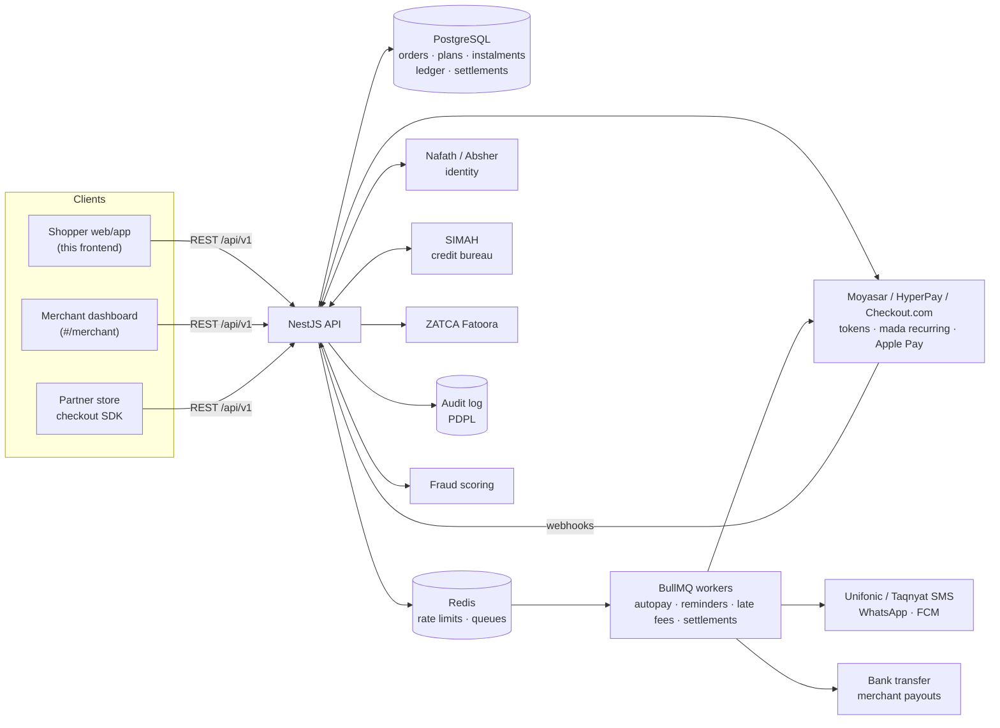
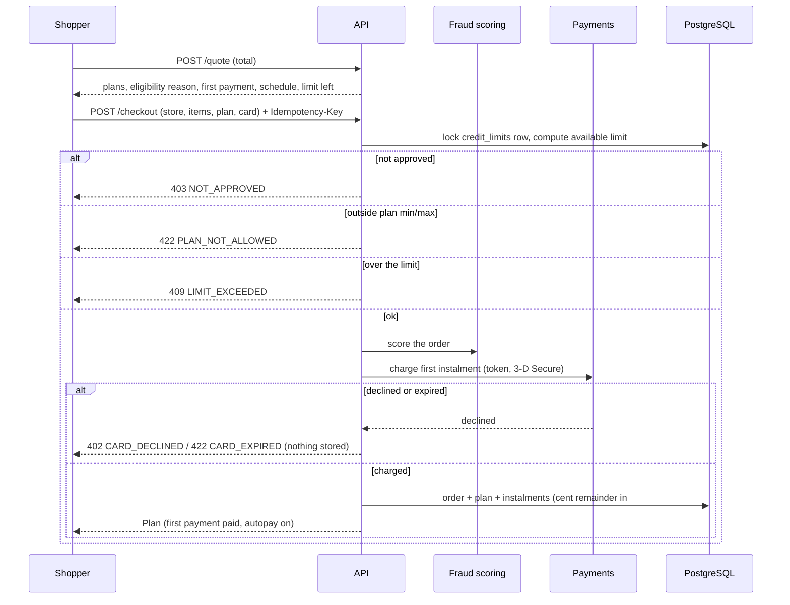
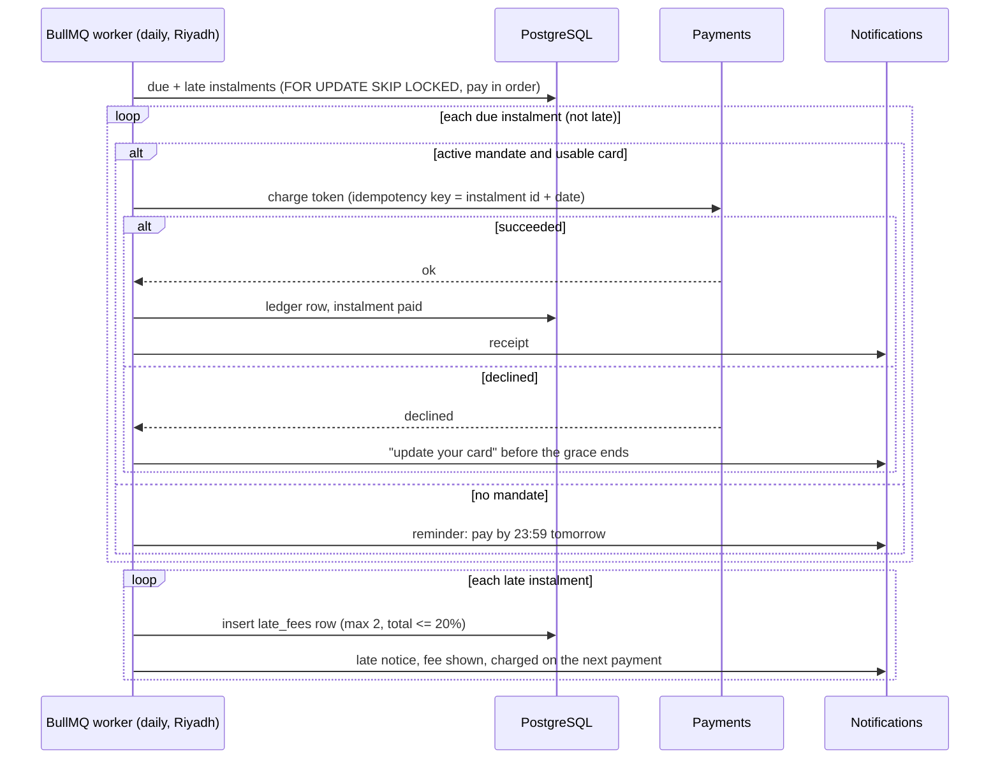

# Qist — architecture

## Frontend (built)

| Concern | Choice | Why |
| --- | --- | --- |
| App | React 19 + TypeScript + Vite, hash routing, served at `/projects/qist/` | Static hosting; every store, plan and settlement screen is a shareable URL |
| Shared core | `@pf/core`: service layer with `VITE_USE_MOCK`, query cache (stale-while-revalidate, polling, invalidation), i18n, theme, lazy pages, mock server | Same plumbing as the other projects |
| Money rules | `src/api/plans.ts` — plan catalogue, halala-exact schedules, grace and late fee, limit tiers and increases, merchant fee, T+2 settlement date, refund split — imported by the UI and the mock | The preview a shopper sees and the server's answer can't disagree |
| Checkout | `/pay/:productId`: product → **plan radiogroup** (each option shows its schedule preview, first payment, limit left and, when unavailable, the reason: below minimum, above maximum, over limit, not verified) → saved card or Apple Pay → confirm. The draft (`qist-checkout`: store, product, qty, plan, card) persists in localStorage so leaving to verify identity or add a card returns to the same basket | The shopper sees exactly what they will pay and when before committing; the server re-validates everything |
| Limit | A **limit ring** (`LimitRing`) with used vs total, the next on-time-plan increase, and a bar on the checkout showing the limit before and after the order | The limit is the one number a BNPL shopper worries about |
| Identity | `/verify`: national ID + income band + employer → instant approval, a short manual review (polled until it resolves) or a decline with a retry date; the ID is never stored | Shows every eligibility outcome without a real bureau |
| Plans | `/plans` list with a segmented progress bar per plan, `/plans/:id` with the timeline, pay one instalment, settle early, change card, autopay switch | One screen per decision |
| Upcoming | `/upcoming` groups the next 30 days by date with overdue first; polls every 30 s | The "what do I owe this week" view |
| Autopay simulation | Mock "time" never advances by itself, so autopay runs **when the shopper opens the app**: `GET /plans` and `GET /me/upcoming` charge every `due` instalment on autopay plans with a usable card; late instalments are left for the shopper so a late fee is never charged silently. `useAutopaySync` refreshes the limit, quote and plan caches when autopay collected something | Demonstrates the nightly job without a server |
| Daily demo refresh | The mock database stores `seededOn`; opening the app on a new day wipes and re-seeds it with dates relative to today | The demo shopper always has a plan due in 3 days and a plan 2 days late |
| Wallet | `/wallet`: saved cards (max 5), default, remove (blocked while autopay uses it); the full number is validated and dropped, only brand, last 4 and expiry are kept | Models tokenised cards; the PAN never lives in state |
| Merchant dashboard | `/merchant`, `/merchant/:section` — Overview (30-day sales, orders, average order value, plan mix, pending settlement, demo conversion uplift), Orders (filter by status, search by code or customer, detail with schedule, partial or full refund), Settlements (batches by T+2 date with gross, fee and net) | The store sees fees and payout dates plainly |
| Roles | Header, tab bar and `Gate.tsx` (`WrongRole`) switch by role; a shopper on a merchant screen (or the reverse) is offered a switch of account | Two products in one app |
| Type | Tajawal (700 headings and numerals, 400 text) in Arabic + Latin subsets, served as files | One family that suits Arabic and Latin, clean at small sizes on phones |
| Perf | **Lean prerendered home** (`src/entry-server.tsx` + `scripts/prerender.mjs` inject the first screen into `index.html`; stores and calculator dates arrive after mount), route chunks per page, the first screen's font and chunks preloaded | Fast first paint on mid-range phones; no layout shift |
| i18n | `src/i18n/ar.ts` and `en.ts`, Arabic (RTL) first, light/dark theme | Saudi shoppers expect Arabic by default |
| Reviewer tools | `DevPanel` (mock mode only): slow the network down or make calls fail to see skeleton, error and retry states | Every state can be shown on purpose |

All of it is a **demo**: the money rules are inspired by SAMA's BNPL rules, not a statement of them or legal advice.

## Backend (to build) — recommended stack

**NestJS (Node 22, TypeScript) + PostgreSQL 16 + Redis + BullMQ**, containerised.

Why for buy now, pay later:

- **Money is a ledger problem.** Integer halalas, an append-only `payments` ledger with an idempotency key, a deferred
  constraint that instalments add up to the order total, and `SELECT … FOR UPDATE` on the limit row make double charges and
  double spending of a limit impossible at the database level (see `database-schema.md`).
- **`due` and `late` are derived**, not stored. The nightly job only has to act on the instalments that crossed a boundary.
- **Time-based jobs** (BullMQ, schedule in `Asia/Riyadh`):
  - **autopay**: charge every `due` instalment of a plan with an active mandate and a usable card (never a late one),
    retry once, mark failures and notify;
  - **reminders**: 3 days before, on the due date and on the grace day (SMS / WhatsApp / push);
  - **late fees**: the day after the grace ends, add the SAR 29 fee (max 2 per plan, total <= 20% of the order) and open a
    collections case; the fee is shown to the shopper and charged only on their next payment;
  - **settlements**: build each store's T+2 batch, pay out by bank transfer, post the ledger entries;
  - limit refresh after a plan completes on time (+SAR 500 per 3 plans), and expiring pending reviews.
- One language end to end: `src/api/types.ts` becomes the shared DTO package and `src/api/plans.ts` the server's rules module.

| Concern | Production choice |
| --- | --- |
| Auth | Phone OTP via **Unifonic / Taqnyat** (Saudi sender ID); JWT access + rotating refresh token; merchants additionally get staff roles and 2FA |
| Identity and eligibility | **Nafath / Absher** national identity to verify the shopper, then a **SIMAH** credit-bureau check and income/employer verification for the limit; the mock's pseudo score (`fakeScore` in `plans.ts`) is replaced by the bureau response. Store only the outcome and a salted hash of the ID |
| Payments | Tokenisation with **Moyasar**, **HyperPay** or **Checkout.com** (mada, Visa, Mastercard, **Apple Pay**) using hosted fields so the backend never sees a PAN; **mada recurring consent** captured per plan for autopay; 3-D Secure on the first charge; webhooks idempotent on `provider_ref` |
| E-invoicing | **ZATCA Fatoora**: the store's invoice to the shopper is the store's duty; Qist issues e-invoices for its own merchant fees (VAT 15% on the fee) |
| Merchant integration | Hosted checkout redirect or JS SDK plus webhooks (`plan.created`, `plan.refunded`, `settlement.paid`); the product catalogue in the mock stands in for the store's cart |
| Collections | Reminder ladder, late-fee waiver by support, hand-off to a licensed collections partner, write-offs; every action in `audit_log` |
| Fraud | Rules + scoring at checkout: velocity per device/phone/card, new-account order size, mismatch between card holder and verified ID, store risk; step-up with Nafath or decline. Chargebacks and disputes link to `refunds` |
| Regulation | A real launch needs the right **SAMA** licence for buy-now-pay-later (the Finance Companies / BNPL framework), responsible-lending checks, clear fee disclosure, maximum late-fee and cool-off rules; the demo's numbers (SAR 29, 20% cap, 2 fees, 6% + SAR 1, 500 per 3 plans) are placeholders to be replaced by the licensed product terms |
| Data protection | **PDPL**: financial and identity data hosted in a Saudi region, explicit consent per purpose (bureau check, autopay, marketing), minimal retention, encryption at rest (KMS), PII masking in logs, an **audit log** of every identity read and money change |
| Notifications | SMS (Unifonic / Taqnyat), WhatsApp Business, **FCM** push; templates in Arabic and English |
| Observability | OpenTelemetry → Grafana; Sentry on web + API; ledger reconciliation against provider reports every day |

## System diagram

## Checkout flow

## Autopay nightly job

## Moving from mock to real

1. Build the API to `docs/api-contract.md`; seed stores and products from `src/mock/seed.ts`.
2. Keep `src/api/plans.ts` and `src/api/cards.ts` as the single rules modules on the server (or port them verbatim), then
   replace the demo constants (fee, caps, tiers) with the licensed product terms.
3. Set `VITE_USE_MOCK=false`, `VITE_API_URL`, and add the API origin and the payment provider's script/frame origins to the CSP.
4. Replace the mock OTP (`1234`) with a real SMS provider and drop `devCode` from the response.
5. Replace `POST /me/eligibility`'s pseudo score with Nafath/Absher identity and a SIMAH check; turn the 8-second mock review
   into a real asynchronous decision (webhook or push) and keep `decidesAt` semantics or poll `GET /me/limit`.
6. Stop sending card numbers to the API: add the provider's hosted fields to `CardForm` and send only a token to
   `POST /me/cards`; the response stays `{ id, brand, last4, expiry, default }`.
7. Move autopay from "runs when the app opens" to the nightly job and keep `GET /plans` and `GET /me/upcoming` read-only;
   add reminders and the late-fee workflow.
8. Replace the derived merchant batches with real settlements, payouts and webhooks; the demo `conversionUplift` figure must
   be measured or removed.
9. Add what the mock leaves out: idempotency keys, an audit log, refunds that move real money back, disputes, and
   decide what `cancelled` plans mean (the status exists in the types but nothing produces it yet).
10. Drop the daily re-seed (`seededOn`) and the `DevPanel`; keep a staging environment with the demo accounts instead.
