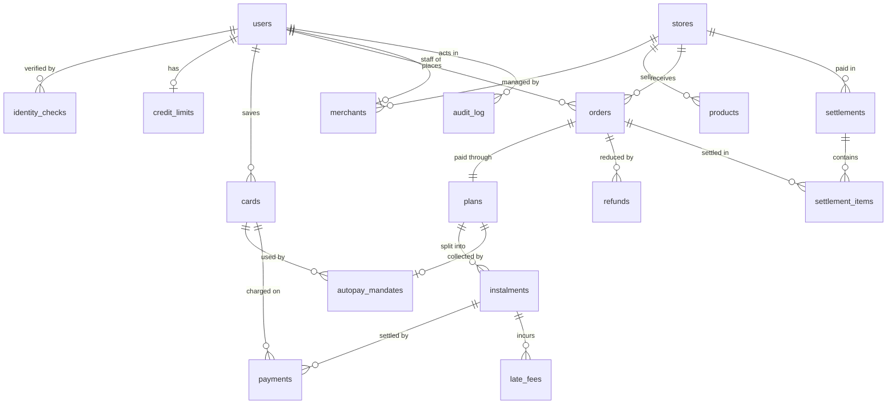

# Qist — database schema

PostgreSQL 16 (recommendation). **Money is stored as integer halalas** (`bigint`, 1 SAR = 100) and converted to SAR
with two decimals at the API edge, so sums are exact and the "remainder in the first payment" rule is plain integer
arithmetic. Bilingual text as `_ar`/`_en` columns; ids `uuid` unless noted; every instalment due date is a local Riyadh
`date`, every event a `timestamptz`. Financial and identity data stays in a Saudi region (PDPL).



## Tables

| Table | Key columns | Notes |
| --- | --- | --- |
| `users` | `id`, `name`, `phone unique` (E.164), `role` (`shopper`/`merchant`), `created_at` | Phone OTP sign-in; the national ID is **not** stored here |
| `identity_checks` | `id`, `user_id`, `provider` (`nafath`/`absher`), `id_hash` (salted, never the raw ID), `bureau` (`simah`), `score smallint`, `income_band`, `employer_type`, `decision` (`approved`/`pending`/`declined`), `reason`, `decided_at`, `retry_after date` | One row per application (audit); the mock's `eligibility` object on the user is the latest row |
| `credit_limits` | `user_id pk`, `base_limit bigint`, `status` (`none`/`pending`/`approved`/`declined`), `updated_at` | Base limit in halalas. The effective limit adds +50,000 halalas per 3 on-time plans, capped at 1,000,000, and is computed, not stored |
| `stores` | `id`, `slug unique`, `name_ar/en`, `tagline_ar/en`, `categories text[]`, `palette text[2]`, `status` | Partner stores |
| `merchants` | `user_id pk`, `store_id`, `role` | Links a `merchant` user to the one store they manage; `CHECK` that the user's role is `merchant` |
| `products` | `id`, `store_id`, `title_ar/en`, `price bigint`, `palette text[2]`, `active` | Price copied into the order at checkout, never read back from here |
| `orders` | `id`, `code unique` (`QS-…`, from a sequence), `user_id`, `store_id`, `customer_display` (first name + initial), `items jsonb` (`[{title_ar,title_en,price,qty}]`), `total bigint`, `refunded_total bigint`, `created_at` | `CHECK (total > 0 AND total <= 2000000)` (SAR 20,000); `refunded_total <= total` |
| `plans` | `id`, `order_id unique`, `plan_type` (`pay4`/`pay3`/`pay6`/`later30`), `count smallint`, `status` (`active`/`completed`/`cancelled`/`refunded`), `autopay bool`, `payment_method_id`, `created_at` | `status` is stored here for fast listing but kept in step with the instalments in the same transaction (the mock derives it on read). `due`/`late` are never columns |
| `instalments` | `id`, `plan_id`, `n smallint`, `due_date date`, `amount bigint` (scheduled, immutable), `refunded bigint` (credited by refunds; owed = `amount - refunded`), `status` (`upcoming`/`paid`/`refunded`), `paid_at`, `late_fee bigint` | **Unique (`plan_id`, `n`)**; `due`/`late` come from `due_date` and `current_date` (grace until the end of the next day) |
| `payments` | `id`, `instalment_id` (null for a refund or fee-only line), `order_id`, `card_id`, `kind` (`charge`/`refund`/`late_fee`), `amount bigint`, `status` (`succeeded`/`declined`/`failed`), `provider` (`moyasar`/`hyperpay`/`checkout`/`applepay`), `provider_ref`, `idempotency_key unique`, `created_at` | **Ledger, append-only**: rows are never updated or deleted; a mistake is a new compensating row |
| `cards` | `id`, `user_id`, `provider_token`, `brand` (`mada`/`visa`/`mastercard`), `last4`, `expiry_month`, `expiry_year`, `is_default`, `deleted_at` | **Token only, never the PAN or CVV.** Soft delete keeps the history of payments |
| `autopay_mandates` | `id`, `plan_id unique`, `card_id`, `consent_at`, `consent_text_version`, `revoked_at` | One consent record per plan (mada recurring); autopay is on while `revoked_at IS NULL` |
| `refunds` | `id`, `order_id`, `amount bigint`, `from_unpaid bigint`, `from_paid bigint`, `reason`, `created_by`, `created_at` | `from_unpaid + from_paid = amount`; the proportional split is applied to `instalments` in the same transaction |
| `settlements` | `id`, `store_id`, `settle_date date`, `status` (`pending`/`paid`), `gross bigint`, `fee bigint`, `net bigint`, `paid_at`, `bank_ref` | **Unique (`store_id`, `settle_date`)**: one batch per store per day |
| `settlement_items` | `settlement_id`, `order_id`, `gross`, `fee`, `net` | pk (`settlement_id`, `order_id`); an order is settled once |
| `late_fees` | `id`, `instalment_id unique`, `plan_id`, `amount bigint`, `applied_on date`, `waived_at`, `waived_by` | Created by the late-fee job. At most 2 per plan, total <= 20% of the order (checked in the job and by trigger) |
| `audit_log` | `id`, `actor_id`, `actor_role`, `action`, `entity`, `entity_id`, `meta jsonb`, `ip`, `at` | Every read of identity data and every change of money state (PDPL) |

The merchant fee and settlement date are computed when the settlement batch is built: `fee = round(net_value × 0.06) + 100`
halalas where `net_value = total − refunded_total`; `settle_date` = order date + 2 working days on a Sunday–Thursday
week (a `working_days` calendar table handles public holidays).

## Key constraints

```sql
-- instalment amounts add up to the plan total, checked once per transaction after all rows are written
CREATE FUNCTION check_instalment_sum() RETURNS trigger LANGUAGE plpgsql AS $$
DECLARE pid uuid := COALESCE(NEW.plan_id, OLD.plan_id);
BEGIN
  IF (SELECT COALESCE(sum(i.amount), 0) FROM instalments i WHERE i.plan_id = pid)
     <> (SELECT o.total FROM plans p JOIN orders o ON o.id = p.order_id WHERE p.id = pid) THEN
    RAISE EXCEPTION 'instalments of plan % do not add up to the order total', pid;
  END IF;
  RETURN NULL;
END $$;
CREATE CONSTRAINT TRIGGER instalment_sum_ck
  AFTER INSERT OR UPDATE OR DELETE ON instalments
  DEFERRABLE INITIALLY DEFERRED FOR EACH ROW EXECUTE FUNCTION check_instalment_sum();

-- one instalment number per plan
ALTER TABLE instalments ADD CONSTRAINT instalments_plan_n_uq UNIQUE (plan_id, n);
ALTER TABLE instalments ADD CHECK (amount >= 0 AND refunded >= 0 AND refunded <= amount);

-- the ledger is append-only
CREATE FUNCTION payments_immutable() RETURNS trigger LANGUAGE plpgsql AS $$
BEGIN RAISE EXCEPTION 'payments is append-only'; END $$;
CREATE TRIGGER payments_no_update BEFORE UPDATE OR DELETE ON payments
  FOR EACH ROW EXECUTE FUNCTION payments_immutable();
REVOKE UPDATE, DELETE, TRUNCATE ON payments FROM app_role;

-- a retried request or a re-delivered webhook cannot charge twice
ALTER TABLE payments ADD CONSTRAINT payments_idem_uq UNIQUE (idempotency_key);
CREATE UNIQUE INDEX payments_one_success_per_instalment
  ON payments (instalment_id) WHERE kind = 'charge' AND status = 'succeeded';

-- a card is a token, never a number
ALTER TABLE cards ADD CHECK (last4 ~ '^[0-9]{4}$' AND provider_token IS NOT NULL);

-- one active autopay mandate per plan; one settlement per store per day
CREATE UNIQUE INDEX autopay_active_uq ON autopay_mandates (plan_id) WHERE revoked_at IS NULL;
ALTER TABLE settlements ADD CONSTRAINT settlements_store_day_uq UNIQUE (store_id, settle_date);
```

Because the sum trigger is deferred, creating a plan inserts the order, plan and all instalments (the cent remainder in
instalment 1) in one transaction. `amount` is the scheduled amount and never changes; a refund only raises `refunded` (unpaid
instalments shrink their owed amount, paid ones are credited back), so the trigger keeps holding. The API maps `payments_idem_uq` to a replay of
the original response (clients send an `Idempotency-Key` header) and `ALREADY_PAID` for the partial unique index.
The "pay in order" and limit checks are enforced in the service with `SELECT … FOR UPDATE` on the plan and the user's
`credit_limits` row, so two parallel checkouts cannot both spend the same limit.

## Key queries

```sql
-- due and late instalments for the nightly autopay / late-fee job ($1 = today in Asia/Riyadh)
SELECT i.id, i.plan_id, i.n, i.amount - i.refunded AS amount, i.due_date,
       (i.due_date + 1 < $1) AS is_late,                      -- grace: on time through 23:59 of the next day
       m.card_id, c.provider_token
FROM instalments i
JOIN plans p ON p.id = i.plan_id AND p.status = 'active'
LEFT JOIN autopay_mandates m ON m.plan_id = p.id AND m.revoked_at IS NULL
LEFT JOIN cards c ON c.id = m.card_id AND c.deleted_at IS NULL
WHERE i.status = 'upcoming' AND i.due_date <= $1
  AND NOT EXISTS (SELECT 1 FROM instalments e                 -- pay in order
                  WHERE e.plan_id = i.plan_id AND e.n < i.n AND e.status = 'upcoming')
ORDER BY i.due_date, i.plan_id, i.n
FOR UPDATE OF i SKIP LOCKED;
-- not late + active mandate + usable card -> charge it; late -> add a late_fees row (never auto-charged)

-- available limit for a shopper ($1 user): effective limit minus principal still outstanding on active plans
WITH on_time AS (
  SELECT count(*) AS n FROM plans p JOIN orders o ON o.id = p.order_id
  WHERE o.user_id = $1 AND p.status = 'completed'
    AND NOT EXISTS (SELECT 1 FROM late_fees f WHERE f.plan_id = p.id)
), used AS (
  SELECT COALESCE(sum(i.amount - i.refunded), 0) AS halalas FROM instalments i
  JOIN plans p ON p.id = i.plan_id AND p.status = 'active'
  JOIN orders o ON o.id = p.order_id
  WHERE o.user_id = $1 AND i.status = 'upcoming'
)
SELECT l.status,
       CASE WHEN l.status = 'approved'
            THEN LEAST(1000000, l.base_limit + 50000 * (on_time.n / 3)) ELSE 0 END AS "limit",
       used.halalas AS used,
       GREATEST(0, CASE WHEN l.status = 'approved'
                        THEN LEAST(1000000, l.base_limit + 50000 * (on_time.n / 3)) - used.halalas ELSE 0 END) AS available
FROM credit_limits l, on_time, used
WHERE l.user_id = $1;

-- merchant settlement batch ($1 = settlement date, $2 store): orders that settle today, net of refunds
SELECT o.store_id, o.id AS order_id,
       (o.total - o.refunded_total) AS gross,
       round((o.total - o.refunded_total) * 0.06)::bigint + 100 AS fee,
       (o.total - o.refunded_total) - (round((o.total - o.refunded_total) * 0.06)::bigint + 100) AS net
FROM orders o
WHERE o.store_id = $2
  AND o.total - o.refunded_total > 0
  AND settle_date_for(o.created_at AT TIME ZONE 'Asia/Riyadh') = $1   -- T+2 working days, Sun-Thu
  AND NOT EXISTS (SELECT 1 FROM settlement_items si WHERE si.order_id = o.id);
-- the job inserts one settlements row (unique store + date) and its settlement_items, then pays out via bank transfer
```

## How the mock mirrors it

The mock keeps the same shape in localStorage (`pf-db:qist`, `src/mock/seed.ts`, `Db` interface): `users` (with the
eligibility outcome inline and the base limit, no national ID), `cards` (brand, last 4, expiry, default; no number),
`stores`, `products`, `orders` (each order carries its plan: `planType`, `payments[]` = the instalments with
`status`/`paidAt`/`method`/`lateFee`/`refunded`, `autopay`, `paymentMethodId`, `refunded`), `otps`, and a `seq` counter for `QS-`
codes. There is no ledger, mandate, settlement or late-fee table: `due`, `late`, late fees, the plan status, the limit in use,
fees, net and settlement batches are all **derived on read** from today's date by `src/api/plans.ts`. The seeded
`seededOn` date makes the mock wipe and re-seed itself when the day changes, so the demo accounts always have an instalment
due soon and one late. One difference: the mock shrinks `amount` of unpaid instalments on a refund (and records `refunded`), while the schema keeps `amount` immutable and derives the owed amount.
